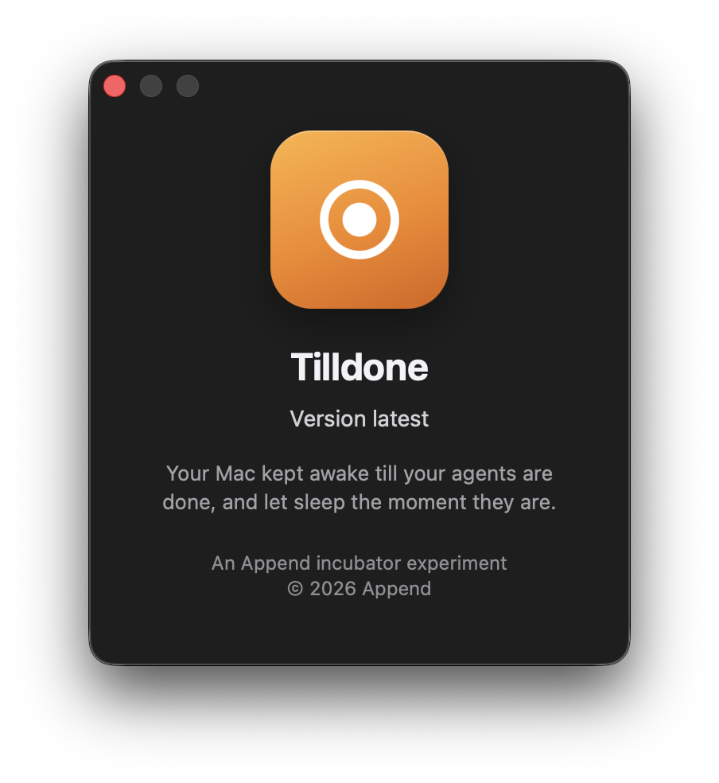

# Tilldone

Keeps your Mac awake till your agents are done.

<p align="center">
  
</p>

Start a long piece of work, tell your agent "keep the Mac awake till you finish", and walk away. Tilldone holds the Mac
while the work runs, and lets it sleep the moment it is done. If the agent's session ends, however it ends, its hold
goes with it: the Mac is never left held.

## Requirements

- macOS, on Apple silicon or Intel.
- Node.js 18 or later.

## Install

### For your agent

Give Tilldone to Claude Code, for every project:

```sh
claude mcp add -s user tilldone -- npx -y tilldone@latest mcp
```

Start a new session, and your agent has three tools: `hold`, `release` and `status`. Ask it to keep the Mac awake till
the work is done; it holds the Mac before the work and releases it as its last step.

Any other agent that speaks MCP runs the same server: `npx -y tilldone@latest mcp`.

### For your terminal

```sh
npm install -g tilldone
```

Then keep the Mac awake while a command runs, or hold it yourself:

```sh
tilldone run -- npm run build
tilldone hold --minutes 90 --reason "the nightly build"
tilldone status
tilldone release
```

`tilldone --help` lists every command.

### The menu bar

There is nothing more to install. Tilldone's menu bar app opens on its own the first time anything asks it to hold.
From its menu you see what holds the Mac and why, keep it awake yourself, and release any hold. To have it open at
every login, turn on **Open at login** in its Settings.

## Update

```sh
npm install -g tilldone@latest
```

Your agent's `npx -y tilldone@latest` checks for the latest version each time a session starts. Quit Tilldone from its
menu once, and the next hold opens the new one.

## Uninstall

1. Turn off **Open at login** in Tilldone's Settings, then choose **Quit Tilldone** from its menu.
2. Remove it from your agent and your terminal:

   ```sh
   claude mcp remove -s user tilldone
   npm uninstall -g tilldone
   ```

3. Remove its folder: `rm -rf ~/Library/Application\ Support/tilldone`.

## License

Free to use, at home and at work. Tilldone is [Append](https://append.dev)'s; its source is not published.

© 2026 Append
